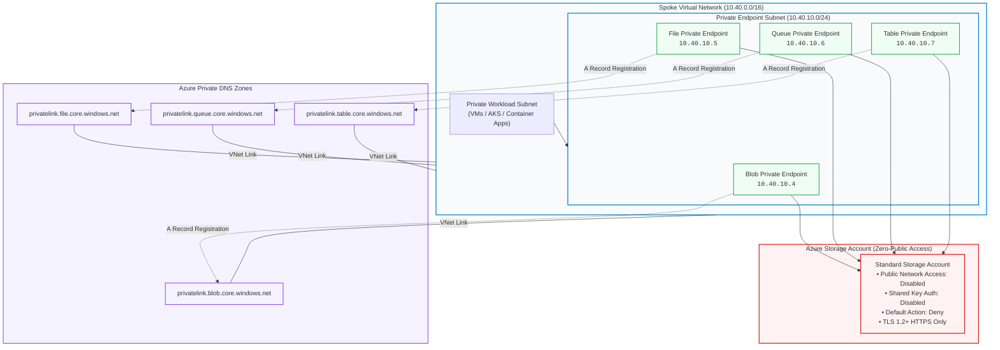
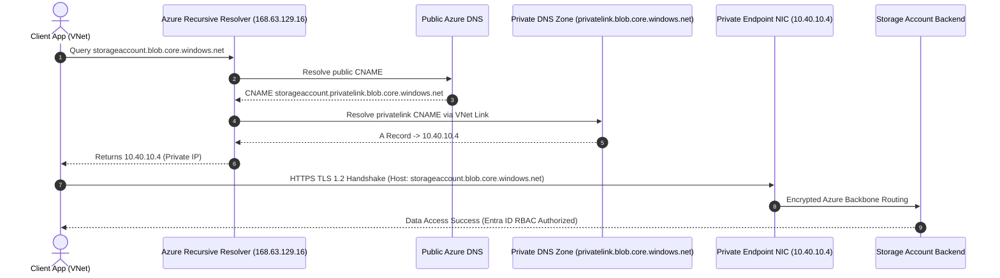

# Azure Storage Private Link with Terraform

[](docs/EVIDENCE.md)
[](https://github.com/sanjiivsingh/azure-storage-private-link-terraform/actions)
[](LICENSE)
[](https://www.terraform.io)
[](https://registry.terraform.io/providers/hashicorp/azurerm/latest)
[](checkov.yaml)

A production-grade, modular Terraform reference architecture establishing **zero-public-access Azure Storage** via **Azure Private Link, dedicated Private Endpoints, and Private DNS Zone Groups**.

This platform provisions an isolated spoke Virtual Network with a dedicated Private Endpoint subnet, a hardened Azure Storage Account (Blob, File, Queue, Table), and automatically manages the DNS CNAME delegation chain for transparent, private-only data access without exposed public endpoints or storage access keys.

---

## 🏛️ Architecture Overview



---

## 🔄 Private DNS Resolution Sequence

When client workloads in the spoke VNet make requests to standard public FQDNs (e.g. `storageaccount.blob.core.windows.net`), the resolution follows an automatic CNAME alias chain to the Private Link IP:



---

## 📁 Repository Structure

```text
azure-storage-private-link-terraform/
├── .github/
│   └── workflows/
│       └── terraform-ci.yml           # Automated CI: fmt, validate, tflint, checkov, gitleaks
├── diagrams/
│   ├── architecture.mmd               # Architecture flowchart definition
│   └── dns-resolution.mmd             # DNS sequence diagram definition
├── docs/
│   ├── ADR/
│   │   └── 0001-per-subresource-private-endpoints.md # Architecture Decision Record
│   ├── architecture.md                # System topology and subnet sizing
│   ├── deployment.md                  # Deployment steps and backend configuration
│   ├── dns-and-private-link.md        # DNS delegation and hybrid forwarding patterns
│   ├── operations-and-troubleshooting.md # KQL queries, routing validation, DNS debugging
│   ├── security-and-best-practices.md # Zero-Trust compliance and Entra ID RBAC
│   └── EVIDENCE.md                    # Verification records and static analysis audit
├── environments/
│   └── dev/
│       ├── main.tf                    # Environment root composition
│       ├── variables.tf               # Parameter declarations with type validation
│       ├── outputs.tf                 # Exported resource IDs, endpoints, and IPs
│       ├── providers.tf               # Provider requirements (azurerm ~> 4.0, random ~> 3.6)
│       ├── backend.tf.example         # Production remote state template
│       └── terraform.tfvars.example   # Example parameter values
├── modules/
│   ├── networking/                    # Spoke VNet and dedicated PE subnet
│   │   ├── main.tf
│   │   ├── variables.tf
│   │   ├── outputs.tf
│   │   └── versions.tf
│   ├── storage/                       # Hardened Storage Account with soft delete & OAuth
│   │   ├── main.tf
│   │   ├── variables.tf
│   │   ├── outputs.tf
│   │   └── versions.tf
│   └── private-endpoint/              # PE per subresource and Private DNS zone group
│       ├── main.tf
│       ├── locals.tf
│       ├── variables.tf
│       ├── outputs.tf
│       └── versions.tf
├── .gitignore
├── .tflint.hcl                        # TFLint ruleset configuration
├── checkov.yaml                       # Static analysis security baseline configuration
├── LICENSE                            # MIT License
└── README.md
```

---

## 🔒 Enterprise Security Guardrails

| Control Area | Implementation Details | CIS Azure Benchmark |
| :--- | :--- | :---: |
| **Public Network Access** | Explicitly disabled (`public_network_access_enabled = false`). All public IPs rejected at the edge. | CIS 5.1 |
| **Network Rule Action** | Default action set to `Deny` with `AzureServices` bypass for platform monitoring. | CIS 5.2 |
| **Authentication Model** | Storage shared access keys disabled (`shared_access_key_enabled = false`). OAuth default enabled (`default_to_oauth_authentication = true`). Access strictly governed by Microsoft Entra ID RBAC. | CIS 5.3 |
| **Transport Encryption** | Minimum TLS version constrained to `TLS1_2`. HTTPS-only traffic enforced. | CIS 5.4 |
| **Data Retention** | Blob versioning enabled with 7-day soft delete retention for both blobs and containers. | CIS 5.5 |
| **SAS Expiration Policy** | Explicit SAS policy configured with 90-day expiration limit and audit logging. | CKV2_AZURE_41 |
| **DNS Split-Brain Defense** | `private_dns_zone_group` configures automated Azure-managed dynamic A records directly upon endpoint provisioning. | CAF Best Practice |

---

## 🚀 Quickstart & Deployment

### Prerequisites
- [Terraform](https://www.terraform.io/) `>= 1.6.0` (Recommended `>= 1.9.0`)
- [Azure CLI](https://learn.microsoft.com/en-us/cli/azure/install-azure-cli) `>= 2.50.0`
- Contributor / Owner permissions on the target Azure Subscription

### Local Deployment

```bash
# 1. Clone repository
git clone https://github.com/sanjiivsingh/azure-storage-private-link-terraform.git
cd azure-storage-private-link-terraform/environments/dev

# 2. Authenticate to Azure CLI
az login
az account set --subscription "<YOUR_SUBSCRIPTION_ID>"

# 3. Configure parameters
cp terraform.tfvars.example terraform.tfvars
# Update subscription_id, location, and name_prefix in terraform.tfvars

# 4. Initialize Terraform
terraform init

# 5. Format and validate
terraform fmt -recursive
terraform validate

# 6. Execute Plan & Apply
terraform plan -out=tfplan
terraform apply tfplan
```

### Production Remote State
For enterprise production environments, configure the Azure Blob remote backend:
1. Rename `backend.tf.example` to `backend.tf`.
2. Populate `resource_group_name`, `storage_account_name`, `container_name`, and `key`.
3. Reinitialize: `terraform init -migrate-state`.

---

## 🧪 Quality Gates & CI Pipeline

Every push and pull request executes an automated verification pipeline defined in [`.github/workflows/terraform-ci.yml`](.github/workflows/terraform-ci.yml):

```bash
# Run formatting check
terraform fmt -check -recursive

# Validate environment syntax
cd environments/dev && terraform init -backend=false && terraform validate && cd ../..

# Run TFLint across all modules
tflint --init && tflint --recursive

# Run Checkov static security analysis
checkov -d . --config-file checkov.yaml

# Run Gitleaks credential detection
gitleaks dir . -v
```

Audit logs and reproduction instructions are documented in [docs/EVIDENCE.md](docs/EVIDENCE.md).

---

## 📚 Architectural Decision Records & Documentation

- [docs/ADR/0001-per-subresource-private-endpoints.md](docs/ADR/0001-per-subresource-private-endpoints.md) - Rationale for distinct Private Endpoints per storage subresource.
- [docs/architecture.md](docs/architecture.md) - Subnet sizing, hub-and-spoke topology integration.
- [docs/dns-and-private-link.md](docs/dns-and-private-link.md) - Private DNS zone groups and hybrid resolver patterns.
- [docs/security-and-best-practices.md](docs/security-and-best-practices.md) - Microsoft Entra ID RBAC roles and Zero-Trust architecture.
- [docs/operations-and-troubleshooting.md](docs/operations-and-troubleshooting.md) - Connection troubleshooting and KQL monitoring queries.
- [docs/deployment.md](docs/deployment.md) - Step-by-step production rollout guide.

---

## 👤 Author & Architecture Inquiries

**Sanjeev Singh**  
*Senior Azure Cloud Architect & DevSecOps Platform Engineer*  
- **Portfolio**: [sanjeevsingh.oneps.in](https://sanjeevsingh.oneps.in)  
- **GitHub**: [@sanjiivsingh](https://github.com/sanjiivsingh)  
- **Case Study**: [Trading Platform Infrastructure Case Study](https://github.com/sanjiivsingh/sanjiivsingh/blob/main/case-studies/trading-platform.md)  
- **Contact**: [Submit Project Inquiry](https://sanjeevsingh.oneps.in/#contact)

---

## 📄 License

This reference architecture is open-source under the [MIT License](LICENSE).
